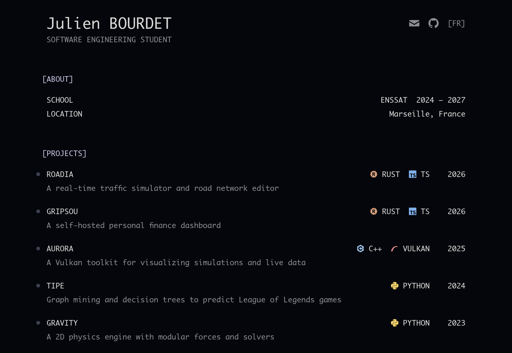

# portfolio

My personal site at [bourdet.be](https://bourdet.be): a short list of my main
projects, each with its own page. Plain HTML and TypeScript built with Vite, no UI
framework. The look follows the Aurora style.



## Run locally

```sh
npm install
npm run dev
```

`npm run build` type-checks and writes the static site to `dist/`.
`npm run preview` serves that build.
## Deploy

The Docker image builds the site and serves it with Caddy. `compose.yaml` attaches
it to an existing external Docker network called `web`, where a reverse proxy
routes to `portfolio:80`.

```sh
git pull
docker compose up -d --build
```
